# Diagrama Entidad-Relación (ERD) - Base de Datos SIGM-MDC
**Municipalidad Distrital de Castilla &bull; Oficina de Desarrollo Tecnológico (ODT)**  
*Motor: PostgreSQL 16 &bull; ORM: TypeORM &bull; Esquema Físico Relacional*

---

## 1. Visión General del Modelo de Datos

La base de datos del **SIGM-MDC** está organizada en **3 grandes dominios funcionales interoperables**, integrados mediante claves foráneas y restricciones de integridad referencial:

1. **Núcleo Municipal (`core_*`)**:
   - Centraliza el catálogo de subsistemas distritales (`core_modules`).
   - Gestión de identidades ciudadanas y funcionarios municipales (`core_people`).
   - Cuentas de acceso, credenciales y módulos autorizados (`core_users`).
   - Estructura orgánica y jerarquía de dependencias con sedes (`core_offices`).
   - Matriz de roles y catálogo granular de permisos (`core_roles`, `core_permissions`).

2. **Gestión de Activos TI (`itam_*`)**:
   - Parque tecnológico institucional con correlativos automáticos y código QR (`itam_assets`).
   - Catálogos paramétricos: Marcas (`itam_asset_brands`), Modelos (`itam_asset_models`) y Categorías adaptativas con esquemas JSONB (`itam_asset_categories`).
   - Trazabilidad y actas oficiales de movimiento/transferencia (`itam_asset_movements`).
   - Órdenes de trabajo preventivas y correctivas (`itam_maintenance_orders`).
   - Almacén de insumos, consumibles y umbrales de stock crítico (`itam_supplies`, `itam_maintenance_supplies`).
   - Préstamos temporales de reserva para eventos/concejo (`itam_asset_loans`, `itam_asset_loan_items`).
   - Auditorías e inventario físico anual con conciliación (`itam_inventory_audits`, `itam_audit_verifications`).
   - Inventario de software y asignación de licencias (`itam_software`, `itam_asset_software`).

3. **Mesa de Ayuda y Soporte Técnico (`helpdesk_*`)**:
   - Registro y ciclo de vida de incidencias (`helpdesk_tickets`).
   - Diagnóstico técnico, soluciones aplicadas y bajas definitivas (`helpdesk_ticket_technical_details`).
   - Descargo y consumo de repuestos de almacén vinculados al ticket (`helpdesk_ticket_supplies`).
   - Asignación de equipos de sustitución temporal durante reparaciones (`helpdesk_ticket_loans`).
   - Trazabilidad cronológica inmutable de auditoría (`helpdesk_ticket_audit_logs`).
   - Repositorio institucional de guías técnicas estandarizadas (`helpdesk_knowledge_articles`).

---

## 2. Diagrama Entidad-Relación (Mermaid)

```mermaid
erDiagram
    %% =========================================================================
    %% DOMINIO: CORE MUNICIPAL
    %% =========================================================================

    core_modules {
        uuid id PK
        varchar code UK
        varchar name
        text description
        varchar icon_url
        varchar route
        varchar accent_color
        int order
        boolean is_active
        boolean requires_auth
        jsonb secondary_action
        boolean is_under_maintenance
        text maintenance_message
        varchar estimated_recovery_time
        timestamptz created_at
        timestamptz updated_at
    }

    core_offices {
        uuid id PK
        varchar code UK
        varchar acronym
        varchar name
        varchar parent_name
        uuid parent_id FK
        varchar sede
        int level
        boolean is_active
        timestamp created_at
        timestamp updated_at
    }

    core_people {
        uuid id PK
        varchar type
        varchar document_type
        varchar document_number UK
        varchar first_name
        varchar paternal_surname
        varchar maternal_surname
        varchar email
        varchar phone
        varchar address
        varchar position
        varchar office
        varchar labor_condition
        varchar entry_date
        varchar business_name
        boolean allows_online_access
        varchar labor_status
        varchar departure_date
        varchar cessation_reason
        boolean is_active
        timestamptz created_at
        timestamptz updated_at
    }

    core_users {
        uuid id PK
        varchar username UK
        varchar password_hash
        varchar full_name
        varchar email
        varchar role
        text_array allowed_modules
        boolean is_active
        uuid person_id FK
        timestamptz created_at
        timestamptz updated_at
    }

    core_roles {
        uuid id PK
        varchar code UK
        varchar name
        text description
        varchar subsystem_code
        boolean is_system
        text_array permission_codes
        boolean is_active
        timestamptz created_at
        timestamptz updated_at
    }

    core_permissions {
        uuid id PK
        varchar code UK
        varchar name
        text description
        varchar subsystem_code
        varchar category
        boolean is_active
        timestamptz created_at
        timestamptz updated_at
    }

    %% =========================================================================
    %% DOMINIO: ITAM (GESTIÓN DE ACTIVOS TI)
    %% =========================================================================

    itam_asset_categories {
        uuid id PK
        varchar code UK
        varchar name
        text description
        varchar icon
        varchar color
        jsonb custom_fields_schema
        boolean is_active
        timestamptz created_at
        timestamptz updated_at
    }

    itam_asset_brands {
        uuid id PK
        varchar name UK
        text description
        boolean is_active
        timestamptz created_at
        timestamptz updated_at
    }

    itam_asset_models {
        uuid id PK
        varchar name
        uuid brand_id FK
        uuid category_id FK
        text description
        boolean is_active
        timestamptz created_at
        timestamptz updated_at
    }

    itam_assets {
        uuid id PK
        varchar computer_code UK
        varchar patrimonial_code
        varchar serial_number
        uuid category_id FK
        uuid brand_id FK
        uuid model_id FK
        uuid parent_asset_id FK
        varchar color
        varchar status
        varchar physical_condition
        varchar office
        uuid assigned_person_id FK
        varchar acquisition_date
        varchar supplier
        varchar warranty_end_date
        boolean is_loanable
        jsonb specifications
        text notes
        boolean is_active
        timestamptz created_at
        timestamptz updated_at
        timestamptz deleted_at
    }

    itam_asset_movements {
        uuid id PK
        varchar acta_number UK
        uuid asset_id FK
        varchar from_office
        varchar to_office
        uuid from_person_id FK
        uuid to_person_id FK
        varchar movement_date
        varchar movement_type
        text reason
        varchar technician_name
        text notes
        boolean include_children_in_transfer
        timestamptz created_at
    }

    itam_maintenance_orders {
        uuid id PK
        varchar code UK
        varchar order_number
        uuid asset_id FK
        varchar type
        varchar status
        varchar priority
        varchar scheduled_date
        varchar completed_date
        text reported_failure
        text diagnosis
        text actions_taken
        varchar technician_name
        text notes
        timestamptz created_at
        timestamptz updated_at
    }

    itam_supplies {
        uuid id PK
        varchar code UK
        varchar name
        varchar category
        int stock
        int min_stock
        varchar unit
        decimal unit_cost
        varchar location
        text compatible_models
        text notes
        boolean is_active
        timestamptz created_at
        timestamptz updated_at
    }

    itam_maintenance_supplies {
        uuid id PK
        uuid maintenance_order_id FK
        uuid supply_id FK
        int quantity
        decimal unit_cost
    }

    itam_asset_loans {
        uuid id PK
        varchar loan_code UK
        varchar loan_number
        varchar requesting_office
        uuid requesting_person_id FK
        varchar borrower_name
        varchar start_date
        varchar expected_return_date
        varchar actual_return_date
        text event_reason
        varchar status
        varchar return_condition
        varchar technician_name
        text notes
        timestamptz created_at
        timestamptz updated_at
    }

    itam_asset_loan_items {
        uuid id PK
        uuid loan_id FK
        uuid asset_id FK
    }

    itam_inventory_audits {
        uuid id PK
        int year
        varchar title
        varchar status
        varchar start_date
        varchar close_date
        jsonb snapshot_data
        text notes
        timestamptz created_at
        timestamptz updated_at
    }

    itam_audit_verifications {
        uuid id PK
        uuid audit_id FK
        uuid asset_id FK
        varchar expected_office
        varchar found_office
        varchar status
        varchar verified_by
        text notes
        timestamptz verified_at
    }

    itam_software {
        uuid id PK
        varchar name
        varchar version
        varchar developer
        varchar license_type
        varchar license_key
        int total_licenses
        varchar expiration_date
        text notes
        boolean is_active
        timestamptz created_at
        timestamptz updated_at
    }

    itam_asset_software {
        uuid id PK
        uuid asset_id FK
        uuid software_id FK
        varchar license_key_used
        timestamptz installed_at
    }

    %% =========================================================================
    %% DOMINIO: HELPDESK & SOPORTE TÉCNICO
    %% =========================================================================

    helpdesk_tickets {
        uuid id PK
        varchar ticket_number UK
        uuid applicant_id FK
        varchar applicant_name
        varchar applicant_phone
        varchar applicant_email
        uuid office_id FK
        varchar office_name
        uuid asset_id FK
        varchar asset_computer_code
        varchar asset_category
        varchar category
        varchar priority
        varchar subject
        text description
        text evidence_photo_url
        varchar status
        uuid assigned_technician_id FK
        varchar assigned_technician_name
        varchar assigned_technician_phone
        timestamptz started_at
        timestamptz resolved_at
        timestamptz closed_at
        boolean user_conformity
        int user_rating
        text user_feedback
        boolean is_locked
        varchar locked_by
        timestamptz created_at
        timestamptz updated_at
        timestamptz deleted_at
    }

    helpdesk_ticket_technical_details {
        uuid id PK
        uuid ticket_id FK
        varchar confirmed_category
        text real_diagnosis
        text solution_applied
        text pause_reason
        boolean is_definitive_decommission
        varchar decommission_act_number
        text decommission_reason
        varchar decommission_destination
        text technician_observations
        timestamptz created_at
        timestamptz updated_at
    }

    helpdesk_ticket_supplies {
        uuid id PK
        uuid ticket_id FK
        uuid supply_id FK
        varchar supply_code
        varchar supply_name
        int quantity
        varchar unit
        decimal unit_cost
        text notes
        timestamptz created_at
    }

    helpdesk_ticket_loans {
        uuid id PK
        uuid ticket_id FK
        uuid temporary_asset_id FK
        varchar temporary_asset_code
        varchar temporary_asset_name
        uuid damaged_asset_id FK
        varchar damaged_asset_code
        varchar damaged_asset_name
        timestamptz delivery_date
        timestamptz return_date
        varchar status
        text notes
        timestamptz created_at
        timestamptz updated_at
    }

    helpdesk_ticket_audit_logs {
        uuid id PK
        uuid ticket_id FK
        varchar previous_status
        varchar new_status
        varchar action
        uuid performed_by_user_id FK
        varchar performed_by_user_name
        text notes
        timestamptz timestamp
    }

    helpdesk_knowledge_articles {
        uuid id PK
        varchar title
        varchar category
        text summary
        text symptoms
        text solution_steps
        text tags
        uuid source_ticket_id FK
        varchar source_ticket_number
        uuid author_technician_id FK
        varchar author_technician_name
        int views_count
        int helpful_count
        boolean is_active
        timestamptz created_at
        timestamptz updated_at
    }

    %% =========================================================================
    %% RELACIONES ENTRE TABLAS (CARDINALIDAD)
    %% =========================================================================

    %% Relaciones Core
    core_offices ||--o{ core_offices : "jerarquia padre-hijo (parent_id)"
    core_people ||--o| core_users : "cuenta de usuario asignada"

    %% Relaciones ITAM Estructurales
    itam_asset_brands ||--o{ itam_asset_models : "fabrica / modelos"
    itam_asset_categories ||--o{ itam_asset_models : "categoriza modelo"
    itam_asset_categories ||--o{ itam_assets : "tipo de equipo"
    itam_asset_brands ||--o{ itam_assets : "marca del activo"
    itam_asset_models ||--o{ itam_assets : "especificacion tecnica"
    itam_assets ||--o{ itam_assets : "componentes / perifericos (parent_asset_id)"
    core_people ||--o{ itam_assets : "funcionario custodio"

    %% Relaciones ITAM Operativas
    itam_assets ||--o{ itam_asset_movements : "trazabilidad de traslados"
    core_people ||--o{ itam_asset_movements : "entrega bien (from_person)"
    core_people ||--o{ itam_asset_movements : "recibe bien (to_person)"

    itam_assets ||--o{ itam_maintenance_orders : "mantenimientos ejecutados"
    itam_maintenance_orders ||--o{ itam_maintenance_supplies : "repuestos consumidos"
    itam_supplies ||--o{ itam_maintenance_supplies : "descargo de stock"

    itam_asset_loans ||--o{ itam_asset_loan_items : "bienes prestados"
    itam_assets ||--o{ itam_asset_loan_items : "activo entregado"
    core_people ||--o{ itam_asset_loans : "solicitante del prestamo"

    itam_inventory_audits ||--o{ itam_audit_verifications : "verificaciones de corte"
    itam_assets ||--o{ itam_audit_verifications : "bien auditado"

    itam_assets ||--o{ itam_asset_software : "software instalado"
    itam_software ||--o{ itam_asset_software : "licencias consumidas"

    %% Relaciones Helpdesk & Soporte
    core_offices ||--o{ helpdesk_tickets : "oficina afectada"
    core_people ||--o{ helpdesk_tickets : "solicitante"
    itam_assets ||--o{ helpdesk_tickets : "equipo que presenta falla"
    core_users ||--o{ helpdesk_tickets : "tecnico asignado"

    helpdesk_tickets ||--|| helpdesk_ticket_technical_details : "informe tecnico / solucion"
    helpdesk_tickets ||--o{ helpdesk_ticket_supplies : "repuestos utilizados"
    itam_supplies ||--o{ helpdesk_ticket_supplies : "insumo de almacen"

    helpdesk_tickets ||--o{ helpdesk_ticket_loans : "sustitucion temporal"
    itam_assets ||--o{ helpdesk_ticket_loans : "activo provisional"
    itam_assets ||--o{ helpdesk_ticket_loans : "activo averiado"

    helpdesk_tickets ||--o{ helpdesk_ticket_audit_logs : "historial de estados"
    core_users ||--o{ helpdesk_ticket_audit_logs : "usuario operador"

    helpdesk_tickets ||--o{ helpdesk_knowledge_articles : "origina guia de solucion"
    core_users ||--o{ helpdesk_knowledge_articles : "autor de la guia"
```

---

## 3. Matriz de Relaciones y Restricciones de Integridad

| Tabla Origen (Hija) | Columna FK | Tabla Destino (Padre) | Cardinalidad | Regla ON DELETE | Descripción de Negocio |
| :--- | :--- | :--- | :--- | :--- | :--- |
| `core_offices` | `parent_id` | `core_offices` | 1 a N (Recursiva) | `SET NULL` | Estructura orgánica municipal (Gerencia &rarr; Subgerencia &rarr; Oficina &rarr; Unidad). |
| `core_users` | `person_id` | `core_people` | 0..1 a 1 | `RESTRICT` | Vinculación del usuario autenticable con el legajo de personal o administrado. |
| `itam_asset_models` | `brand_id` | `itam_asset_brands` | 1 a N | `CASCADE` | Cada modelo tecnológico pertenece estrictamente a una marca fabricante. |
| `itam_asset_models` | `category_id` | `itam_asset_categories` | 0..1 a N | `SET NULL` | Categorización base del modelo de equipo. |
| `itam_assets` | `category_id` | `itam_asset_categories` | 1 a N | `RESTRICT` | Tipo de bien (Computadora, Impresora, Switch, etc.) que define sus campos adaptativos JSONB. |
| `itam_assets` | `brand_id` | `itam_asset_brands` | 1 a N | `RESTRICT` | Marca del activo institucional. |
| `itam_assets` | `model_id` | `itam_asset_models` | 1 a N | `RESTRICT` | Modelo de hardware registrado. |
| `itam_assets` | `parent_asset_id` | `itam_assets` | 1 a N (Recursiva) | `SET NULL` | Relación Padre-Hijo (RF-05): Vinculación de periféricos a una CPU principal. |
| `itam_assets` | `assigned_person_id`| `core_people` | 0..1 a N | `SET NULL` | Servidor municipal custodio legal del bien. |
| `itam_asset_movements`| `asset_id` | `itam_assets` | 1 a N | `CASCADE` | Historial de actas oficiales de asignación, transferencia o devolución. |
| `itam_asset_movements`| `from_person_id` | `core_people` | 0..1 a N | `SET NULL` | Custodio remitente del activo. |
| `itam_asset_movements`| `to_person_id` | `core_people` | 0..1 a N | `SET NULL` | Custodio receptor del activo. |
| `itam_maintenance_orders` | `asset_id` | `itam_assets` | 1 a N | `CASCADE` | Registro de mantenimiento preventivo o correctivo del equipo. |
| `itam_maintenance_supplies` | `maintenance_order_id` | `itam_maintenance_orders` | 1 a N | `CASCADE` | Repuestos y consumibles utilizados en una orden de mantenimiento. |
| `itam_maintenance_supplies` | `supply_id` | `itam_supplies` | 1 a N | `RESTRICT` | Enlace al catálogo de insumos de almacén para control de stock. |
| `itam_asset_loan_items` | `loan_id` | `itam_asset_loans` | 1 a N | `CASCADE` | Activos asociados a una solicitud de préstamo temporal. |
| `itam_asset_loan_items` | `asset_id` | `itam_assets` | 1 a N | `RESTRICT` | Equipos del inventario marcados con `is_loanable = true`. |
| `itam_audit_verifications` | `audit_id` | `itam_inventory_audits` | 1 a N | `CASCADE` | Verificación de inventario físico anual. |
| `itam_audit_verifications` | `asset_id` | `itam_assets` | 1 a N | `CASCADE` | Activo constatado físicamente durante el barrido de auditoría. |
| `itam_asset_software` | `asset_id` | `itam_assets` | 1 a N | `CASCADE` | Tabla intermedia: Software instalado en un equipo. |
| `itam_asset_software` | `software_id` | `itam_software` | 1 a N | `CASCADE` | Catálogo de programas y licencias institucionales. |
| `helpdesk_tickets` | `asset_id` | `itam_assets` | 0..1 a N | `SET NULL` | Equipo tecnológico sobre el cual se reporta la incidencia (código QR). |
| `helpdesk_tickets` | `office_id` | `core_offices` | 0..1 a N | `SET NULL` | Dependencia física donde se suscita el problema. |
| `helpdesk_ticket_technical_details` | `ticket_id` | `helpdesk_tickets` | 1 a 1 | `CASCADE` | Ficha técnica con diagnóstico, solución aplicada y actas de baja. |
| `helpdesk_ticket_supplies` | `ticket_id` | `helpdesk_tickets` | 1 a N | `CASCADE` | Insumos de almacén consumidos para resolver la avería del ticket. |
| `helpdesk_ticket_supplies` | `supply_id` | `itam_supplies` | 1 a N | `RESTRICT` | Descargo automático de existencias en almacén TI. |
| `helpdesk_ticket_loans` | `ticket_id` | `helpdesk_tickets` | 1 a N | `CASCADE` | Equipo provisional prestado mientras el principal permanece en laboratorio. |
| `helpdesk_ticket_loans` | `temporary_asset_id` | `itam_assets` | 1 a N | `RESTRICT` | Equipo provisional entregado al usuario. |
| `helpdesk_ticket_loans` | `damaged_asset_id` | `itam_assets` | 1 a N | `RESTRICT` | Equipo averiado recibido en taller. |
| `helpdesk_ticket_audit_logs` | `ticket_id` | `helpdesk_tickets` | 1 a N | `CASCADE` | Pistas de auditoría inmutables del ciclo de vida del ticket. |
| `helpdesk_knowledge_articles` | `source_ticket_id` | `helpdesk_tickets` | 0..1 a N | `SET NULL` | Caso de soporte que sirvió de base para crear la guía de solución. |

---

## 4. Características de Diseño y Buenas Prácticas Implementadas

1. **Identificadores Universales (`UUID v4`)**: Todas las tablas utilizan claves primarias UUID, lo que elimina colisiones en migraciones, transacciones concurrentes y exportaciones offline.
2. **Borrado Lógico y Trazabilidad (`Soft Delete`)**:
   - `itam_assets.deleted_at` y `helpdesk_tickets.deleted_at` impiden la eliminación física de registros con valor patrimonial o legal.
3. **Esquemas Dinámicos Adaptativos (`JSONB`)**:
   - `itam_asset_categories.custom_fields_schema` y `itam_assets.specifications` permiten definir y almacenar especificaciones técnicas variables (memoria RAM, procesador, dirección IP, número de puertos, tipo de tóner) sin alterar el esquema relacional de la base de datos.
4. **Sanitización y Estandarización de Texto**:
   - Nombres, razones sociales, dependencias y marcas se transforman a **mayúsculas institucionales**, mientras que correos electrónicos y nombres de usuario se normalizan en **minúsculas**.
5. **Auditoría e Inmutabilidad**:
   - Timestamps con zona horaria (`timestamptz`) en todas las operaciones y bitácora completa en `helpdesk_ticket_audit_logs`.
